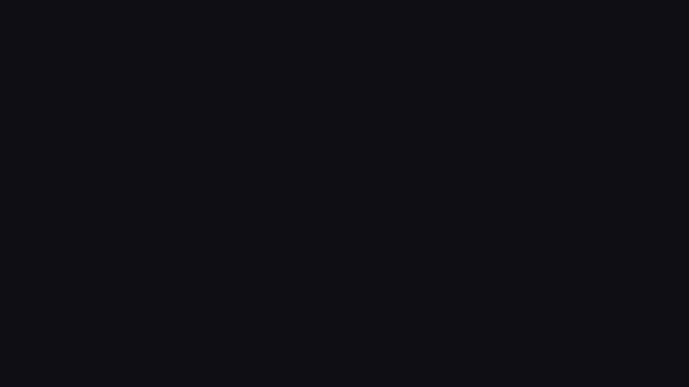

# noise is bad.

A panel for the office television that answers one question from across the room: **how bad are things right now?**



The screen gets noisier as more things break. Healthy services are never drawn: all the space goes to whatever deserves attention right now. It is built to be read at a glance from five to ten metres away, without reading any of the words.

```
NOTHING WRONG   →  quiet, a mark bouncing around the screen
ONE PROBLEM     →  it takes the whole screen
MORE            →  the screen fills with boxes, biggest problem biggest
LASTING LONGER  →  its box grows and its colour strengthens
FIXED           →  the box goes and the others take the space
```

**Try it first.** Add the panel, set **Demo** to *Shipping Incident*, and watch it work before pointing it at anything real.

## What to feed it

One number per service: an **availability**, good events over total events, where 1 is perfect and smaller is worse. Tell it which column or label holds the name. That is the whole setup. Out of the box, below 0.99 is a warning and below 0.95 is critical.

Something else works too. Set the two levels in whatever units your query returns, and say which way the number runs.

| What you have | Worse when | Warning | Critical |
| --- | --- | --- | --- |
| **Availability, ratio** | **Lower** | **0.99** | **0.95** |
| Error budget remaining, ratio | Lower | 0.5 | 0.1 |
| Error budget burned, percent | Higher | 50 | 90 |
| Burn rate | Higher | 6 | 14.4 |
| Plain status number | Higher | 1 | 2 |

The number matters, not just the threshold it crossed: a service at 90% availability gets visibly more screen than one at 94%.

**Sloth and Pyrra work untouched.** For Sloth, query `1 - slo:sli_error:ratio_rate1h` and set the name to `sloth_service`.

**One pair of levels per panel.** The warning and critical levels apply to every service in the query. Services held to different objectives want a panel each, or a number already normalised against each service's target.

A query the panel cannot read says so, rather than showing a calm screen. A service that disappears from the query is held, not cleared, because a missing metric is not a fixed problem.

## Options

| Setting | What it does |
| --- | --- |
| Name, Value | Which column or label to read. Empty means guess. |
| Value to use | Last, worst or average, when a service has several readings. |
| Worse when | Whether a bigger number means a worse problem. |
| Warning, Critical | The levels that count as a warning and as critical. |
| Quiet mode, Quiet mark | What to show when nothing is wrong. |
| Grow with age | Give a long-running problem more of the screen. |
| Transition, Appear and disappear | How boxes move, arrive and leave. |
| Most boxes on screen | The ceiling on boxes. The rest share one saying how many more. |
| Demo | Run a built-in example instead of the query. |

## When nothing is wrong

An empty screen looks like a broken screen, so the panel puts on a screensaver: the DVD logo, changing colour on every wall it hits; the noise is bad. lockup drifting calmly; the Windows XP *3D Text* screensaver rebuilt in CSS; or a split-flap clock.

## Put it on the wall

Make it the only panel on its dashboard and open it with `?kiosk`. It paints its own background and sizes everything from the panel, so a television shows nothing but the answer.

## Learn more

- [Getting started](https://github.com/triwats/noise-is-bad/blob/main/docs/getting-started.md)
- [What data works](https://github.com/triwats/noise-is-bad/blob/main/docs/what-works.md)
- [The metrics guide](https://github.com/triwats/noise-is-bad/blob/main/docs/metrics.md), with example queries for Sloth, Pyrra and plain request counts
- [Website](https://noiseisbad.triwats.com)

## Credits

The DVD logo screensaver draws the DVD Video logo, a trademark of DVD Format/Logo Licensing Corporation. noise is bad. is not affiliated with or endorsed by them. The Boing ball is a tribute to the 1984 Amiga Boing demo by Dale Luck and RJ Mical, redrawn from scratch. The 3D text and flip clock use the Archivo Black typeface under the SIL Open Font License, and the treemap uses d3-hierarchy under the ISC License. Full notices ship with the plugin in `THIRD_PARTY_NOTICES.md`.
